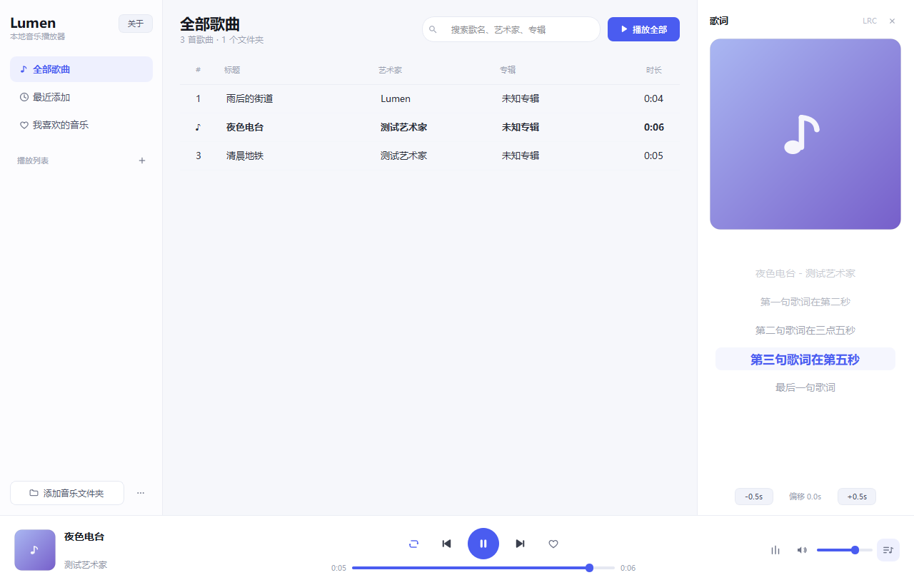
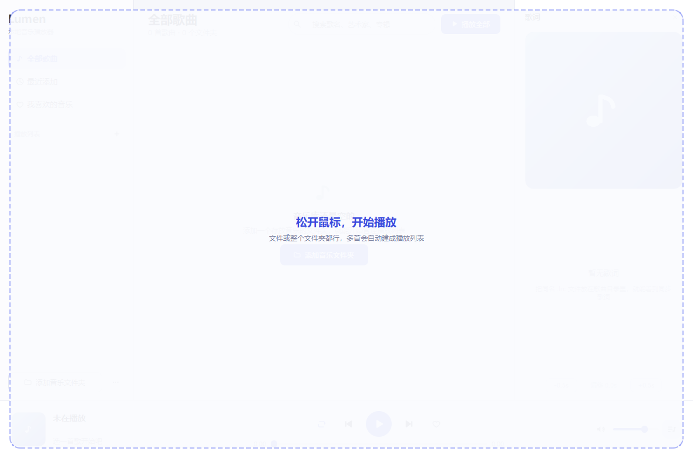
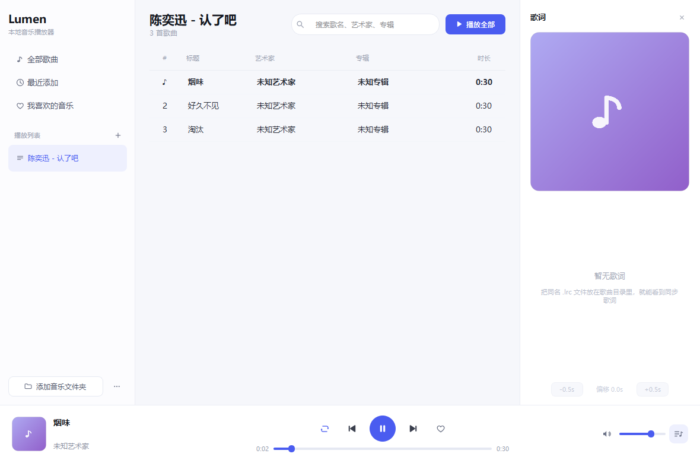
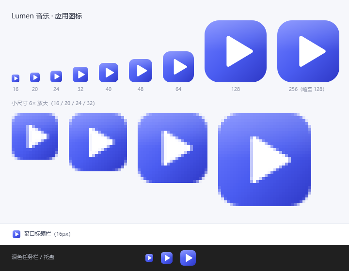
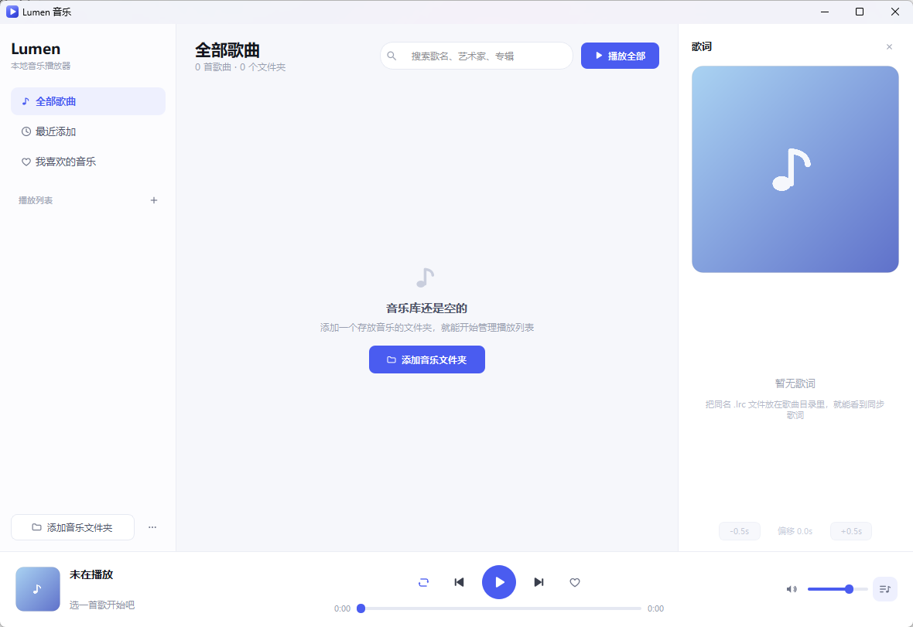

# Lumen 音乐

一个用 **Python + PySide6（Qt6）** 写的本地音频播放器：干净的界面、同步歌词、四种播放模式、
按歌名 / 艺术家 / 专辑搜索，以及自定义播放列表。全部数据存在本地，不联网、不上传。



## 功能

| 模块 | 说明 |
| --- | --- |
| 音乐库 | 添加任意多个音乐文件夹，自动递归扫描；读取 ID3/FLAC/MP4 标签，无标签时从 `01. 艺术家 - 歌名.mp3` 推断；元数据带缓存，二次启动秒开 |
| 播放 | 播放 / 暂停 / 上一首 / 下一首，进度条点击或拖动跳转，音量与静音，空格键控制 |
| 循环模式 | 顺序播放、列表循环（默认）、单曲循环、随机播放，按钮一键切换 |
| 歌词 | 自动查找同名 `.lrc`（歌曲同目录或 `lyrics/` 子目录），支持内嵌歌词；逐行滚动高亮、平滑居中、点击某行跳转到该时间；**可微调歌词偏移（±0.5s）**，每首歌的偏移会记住；滚轮可以手动翻看歌词，停手 2 秒自动回到正在唱的那句（纯文本歌词同样可滚动） |
| 调整顺序 | **按住歌曲行上下拖动**即可调整播放顺序；播放列表里的顺序会保存到磁盘，其它视图里调整过的顺序在本次运行内保留；当前播放队列同步跟随；拖到列表上下边缘会自动滚动 |
| 托盘 | **关闭 / 最小化窗口后驻留托盘继续播放**，托盘菜单可播放暂停、切歌、恢复窗口、退出；可随时关闭这一行为 |
| 媒体键 | **全局媒体键**：键盘上的播放暂停、上一首、下一首、停止键在任意窗口下都能控制（Windows；优先注册系统热键，被占用时自动退回键盘钩子监听） |
| 搜索 | 多关键词搜索（空格分隔，可混搜歌名 + 艺术家 + 专辑 + 文件名），实时过滤，表头可排序 |
| 播放列表 | 新建 / 重命名 / 删除；右键歌曲「添加到播放列表」；从列表移除；收藏（我喜欢的音乐） |
| 导入 | **把文件或文件夹拖进窗口就直接播放**；一次拖多首会自动建成同名播放列表（同一文件夹再拖会复用，不会重复建）；支持 mp3 / flac / m4a / wav / ogg / opus / ape / wma 等，文件夹会递归查找并按 01、02…10 自然排序 |
| 文件关联 | **安装时可勾选注册音频文件关联**，资源管理器里右键音频文件 → 打开方式 → 选 Lumen 音乐（可设为默认）；双击音频文件或命令行传入即直接播放，已运行时转交给现有窗口 |
| 图标 | 自带多尺寸应用图标（`assets/icon.ico`，16–256px），窗口、任务栏、托盘、快捷方式统一；并注册了独立的任务栏应用标识，不会显示成 Python 的图标 |
| 单实例 | 再次双击启动只会把已有窗口叫到前面，不会开出第二个播放器（避免两份 `library.json` 和两套媒体键互相打架） |
| 其它 | 记住窗口大小、音量、播放模式、歌词面板开关、托盘开关；封面自动读取内嵌图片（按控件实际尺寸解码，1500px 大图也不卡），没有封面则生成渐变色块；坏文件自动跳过，不会卡住整个队列；曲库写盘失败会在标题栏下方提示，不会静默丢失 |

## 运行

### 方式一：双击（Windows，推荐）

```
run.bat
```

首次运行会自动创建 `venv` 虚拟环境并安装依赖，之后直接启动（无控制台窗口）。

### 方式二：手动

```bash
python -m venv venv
venv\Scripts\activate          # macOS / Linux: source venv/bin/activate
pip install -r requirements.txt
python main.py                  # 需要看报错时用这个方式
```

要求 Python 3.10+，依赖版本钉在 requirements.txt（PySide6 6.12.0 + mutagen 1.48.1）。

### 音频格式支持

播放能力由 Qt Multimedia 提供：mp3、flac、m4a/aac、wav、ogg/opus、wma 一般都可直接播放。
若遇到无法播放的格式，可在系统安装对应的解码器（如 K-Lite），或转换为 mp3/flac。

## 快捷键

| 快捷键 | 作用 |
| --- | --- |
| `空格` | 播放 / 暂停 |
| `Ctrl + F` | 定位到搜索框 |
| `Ctrl + O` | 添加音乐文件夹 |
| `Ctrl + →` / `Ctrl + ←` | 快进 / 快退 5 秒 |
| `Alt + →` / `Alt + ←` | 下一首 / 上一首 |
| `Delete` | 从当前播放列表中移除选中歌曲 |
| `Esc` | 清空搜索并回到列表 |
| `双击歌曲` | 从该歌曲开始播放当前列表 |
| `上下拖动歌曲行` | 调整播放顺序 |
| `拖入文件 / 文件夹` | 直接开始播放；多首自动建立播放列表 |
| `键盘媒体键` | 播放 / 暂停、上一首、下一首、停止（全局，无需窗口焦点） |

## 拖拽播放

把歌曲文件、一个文件夹，甚至几个文件夹一起拖到窗口里就行——鼠标进入窗口时会浮出一层提示，
松手立刻开始播放。

- **单个文件**：直接播放这一首，不会新建播放列表。
- **多个文件 / 整个文件夹**：自动建一个播放列表并切过去，列表名取文件夹名（单独选了几个文件时
  取它们所在的目录名，来源不一致就叫「拖入的音乐」）。播放顺序按文件名自然排序，
  所以 `01`、`02`、`10` 不会排成 `01`、`10`、`02`。
- **重复拖同一个文件夹**：识别为同一个列表直接复用，不会建出「xxx (2)」。
- 拖进来的位置也会登记到音乐库（下次启动仍在），并顺手读取标签、封面、歌词。
- 一次拖入很多（40 首以上）时，标签在后台线程读，界面不卡；播放会在准备好的瞬间开始。
- 拖进来的如果是非音频文件，会直接忽略并提示「没有找到可播放的音频文件」。





## 托盘与媒体键

点窗口右上角的关闭按钮（或最小化）时，程序会缩到系统托盘继续播放，双击托盘图标可以恢复窗口。
右键托盘图标可以播放暂停、切歌、关闭「最小化到托盘」行为或直接退出。

不想这样可以在两处关掉：托盘右键菜单里的「最小化到托盘」复选框，或左侧 `⋯` 菜单里的同名选项。

全局媒体键在 Windows 上默认开启：优先用 `RegisterHotKey` 注册系统热键；如果媒体键已被别的
程序（某些笔记本自带的播放器、音乐软件）占用，会自动改用更低层的键盘钩子监听——只观察不拦截，
因此不会影响其他程序。部分按键被占用时，注册成功的仍走热键，剩下的用钩子补上，不会出现
「有两个键没反应」。钩子回调里只做投递，实际处理排在事件循环中，不会因为回调超时被系统摘钩。
macOS / Linux 上只支持窗口有焦点时响应媒体键。

## 歌词

把歌词文件放在**歌曲旁边**，文件名与歌曲相同即可自动识别：

```
音乐/
├── 01. 陈奕迅 - 富士山下.flac
├── 01. 陈奕迅 - 富士山下.lrc      ← 同名即可
└── lyrics/
    └── 01. 陈奕迅 - 富士山下.lrc  ← 放在 lyrics 子目录也可以
```

支持标准 LRC 时间轴、`[offset:]` 偏移、一行多时间戳、逐字标签 `<00:12.34>`；编码自动识别
UTF-8 / GBK / Big5。没有 `.lrc` 时会尝试读取音频文件内的内嵌歌词；纯文本歌词也能显示（不滚动）。

歌词和声音对不齐时，用歌词面板底部的 **`-0.5s` / `+0.5s`** 微调：正值表示歌词整体延后出现。
点中间的「偏移 x.xs」可以一键归零。每首歌的偏移量会单独记住，下次播放自动套用。

```lrc
[ti:富士山下]
[ar:陈奕迅]
[00:00.00]富士山下 - 陈奕迅
[00:12.50]拦路雨偏似雪花
```

## 应用图标



标志是代码画出来的（`ui/icons.py` 的 `render_logo()`），再由 `tools/make_icon.py` 导出成
`assets/icon.ico`（16 / 20 / 24 / 32 / 40 / 48 / 64 / 128 / 256 九档，小尺寸用 BMP、大尺寸用 PNG）
和 `assets/icon.png`（512×512，供快捷方式、文档使用）。

所以换图标只需要改 `_logomark()` 里的配色或形状，然后重新导出：

```bash
venv\Scripts\python.exe tools\make_icon.py
```

启动时 `main.py` 会做两件事，让 Windows 正确显示这个图标：

- `QApplication.setWindowIcon()` + 主窗口 `setWindowIcon()` —— 窗口标题栏、Alt+Tab、任务栏按钮；
- `SetCurrentProcessExplicitAppUserModelID("LumenAudio.Lumen.Desktop.1")` —— 独立的任务栏应用标识。
  不设的话，用 `pythonw.exe` 跑起来的窗口会被系统归到 Python 名下，图标也变成 Python 的。

想放到桌面/开始菜单，把 `run.bat` 或者 pythonw 的快捷方式建一个，选「更改图标」指向
`assets\icon.ico` 即可；用 PyInstaller 打包时加 `--icon assets/icon.ico` 就能进 exe。

启动后窗口标题栏的效果：



## 数据与隐私

播放列表、收藏、曲库缓存和窗口设置都保存在本机：

```
%APPDATA%\LumenAudio\Lumen\          (Windows)
~/Library/Application Support/LumenAudio/Lumen/   (macOS)
```

- `library.json`：曲库缓存 + 播放列表 + 收藏（带 `version` 字段，旧版本数据读取时会自动补齐字段；
  内容没变化时不重写文件，写入失败会在界面提示）
- 设置项保存在 `Lumen.ini`（与 `library.json` 同目录，不写系统注册表）

删除这个目录即可恢复到全新状态（不会影响硬盘上的音乐文件）。

## 项目结构

```
main.py                  启动入口（任务栏标识、窗口图标、字体与样式、INI 设置格式）
图标.png                 应用图标（256×256，公司规范位置，关于/打包/官网共用）
assets/
  icon.ico               应用图标（九档尺寸，窗口/任务栏/托盘/快捷方式共用）
  icon.png               512×512 图标位图
core/
  paths.py               应用数据目录、图标路径、任务栏应用标识
  version.py             版本号单一来源（关于对话框 / 安装包 / 官网三处一致）
  metadata.py            音频标签 / 时长 / 封面读取，Track 数据类
  lyrics.py              LRC 解析、同名文件与内嵌歌词查找
  library.py             曲库扫描（后台线程 + 缓存）、拖拽播放的标签线程、播放列表与收藏持久化
  player.py              QMediaPlayer 封装：队列、四种循环模式、音量、随机历史
  media_keys.py          全局媒体键（系统热键 / 低级键盘钩子）
  single_instance.py     单实例保护（重复启动只唤起已有窗口）
  utils.py               时间格式化
ui/
  main_window.py         主窗口：侧边栏、歌曲表格、播放条、托盘、右键菜单、拖拽
  about_dialog.py        标准「关于」对话框（公司统一文案：版本 / 公司 / 网址）
  models.py              歌曲表格模型（含拖动重排）+ 多关键词过滤代理
  lyrics_view.py         歌词面板（自绘、平滑滚动、点击跳转、偏移微调）
  widgets.py             可点击进度条、圆角封面、可拖动排序的歌曲表
  icons.py               QPainter 绘制的矢量图标与应用标志（无图片资源依赖）
  theme.py               配色与 QSS 样式表
tools/
  make_icon.py           导出 assets/icon.ico、icon.png 与图标预览图
  smoke_test.py          端到端冒烟测试（扫描/播放/歌词/搜索/列表，27 项）
  features_test.py       新功能测试（托盘/媒体键/拖动排序/歌词偏移/图标/拖拽播放，114 项）
docs/                    界面截图与图标预览
```

## 测试

```bash
venv\Scripts\python.exe tools\smoke_test.py      # 基础流程，27 项
venv\Scripts\python.exe tools\features_test.py   # 托盘/媒体键/拖动/偏移/图标/拖拽播放，114 项
```

脚本会临时生成几段 WAV 与 LRC 文件，跑通「扫描 → 播放 → 歌词对齐 → 搜索 → 播放列表 → 收藏」，
以及拖动排序、拖拽播放（真实 `QDragEnterEvent` / `QDropEvent`）、托盘隐藏与恢复、
媒体键（会用 `keybd_event` 真的按一次媒体键）、歌词偏移与应用图标，
并输出界面截图到 `docs/`。运行时窗口会短暂弹出、任务栏可能出现托盘图标，属于正常现象。

## 打包（生成安装包）

```
build.bat
```

流程：清空 `dist\` → PyInstaller onedir 无控制台打包（`Lumen音乐.spec`）→
Inno Setup 制作 per-user 免 UAC 安装包（`Lumen音乐.iss`），
输出 `installer_output\Lumen音乐-Setup-1.0.exe`（AppVersion 与 `core/version.py` 一致）。
默认安装到 `%LOCALAPPDATA%\Programs\Lumen 音乐`，卸载后用户数据保留。

## 已知限制

- 暂无在线歌词 / 在线封面下载，完全离线使用
- 不支持 DSD 原始码流（`.dsf` 仅部分平台可播）
- 单曲循环依赖重新加载文件，切歌瞬间有极短间隙

## 仓库说明

本仓库只包含源码，以下运行时资源体积较大，未纳入仓库：

- vendor/vlc/（VLC 播放内核）：从 videolan.org 下载后按 vendor/vlc 结构放入。
